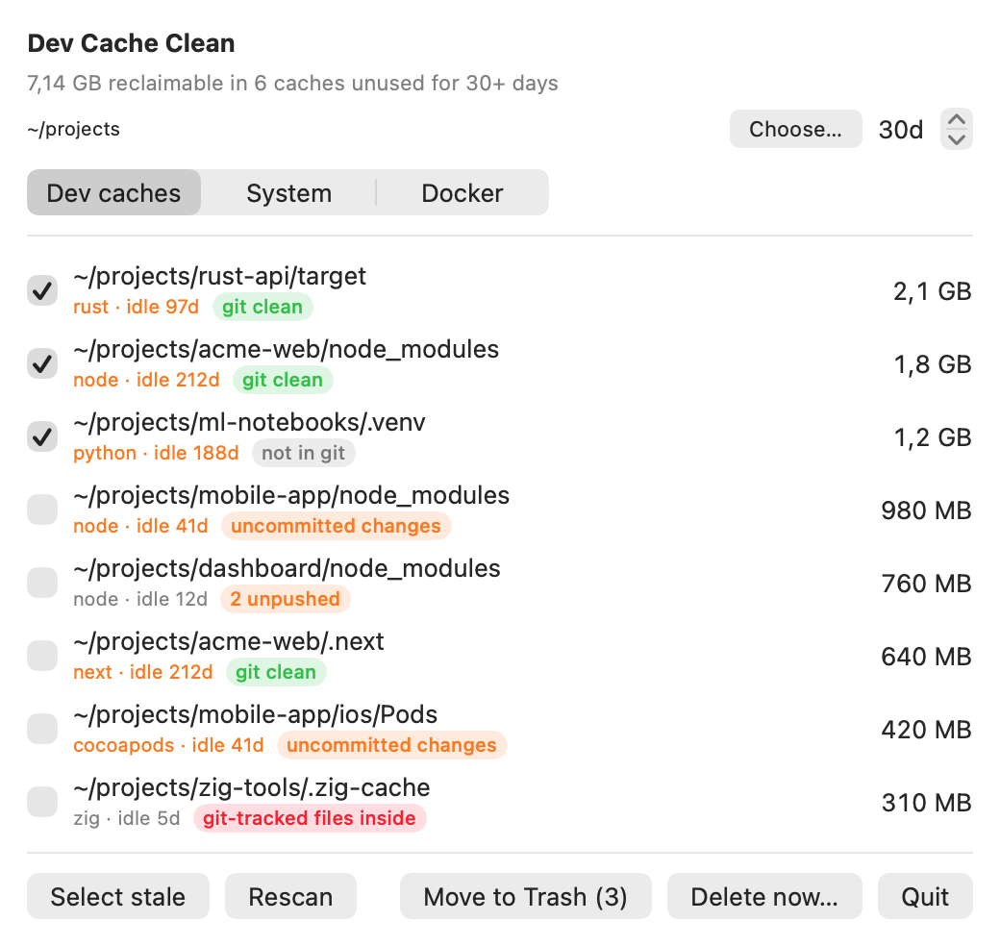
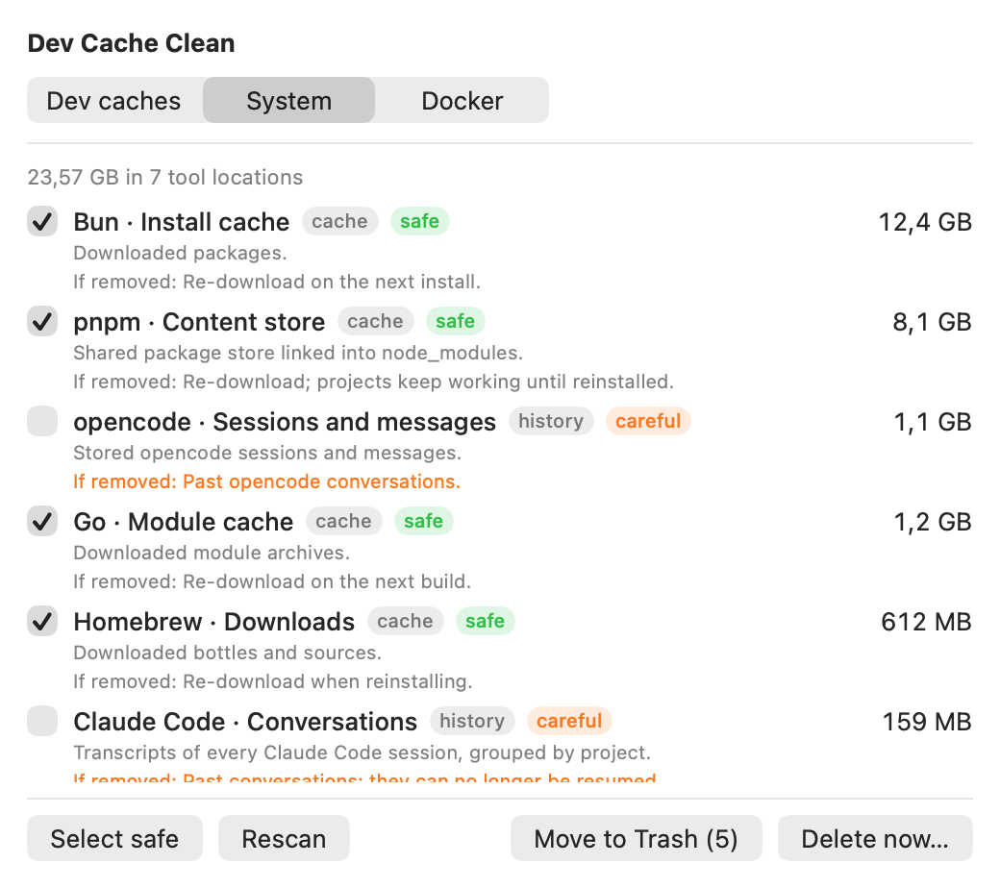
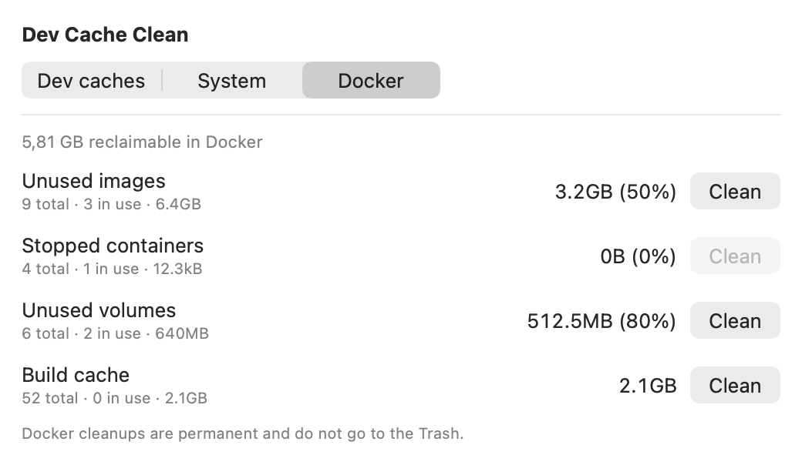

# Dev Cache Clean

**Find the development caches that are silently eating your disk, see exactly what each one is, and clean them safely.**
A native macOS app with a fast Zig core and three tabs: Dev caches, System (global tool data) and Docker. Open source (MIT). Website: <https://developerfred.github.io/dev-limpeza/>

> **Status: early (0.1).** It runs and has been checked against `find` and `du` on a real machine, but it is not notarized, has no installer yet and runs on macOS only. Build it from source with Zig 0.17 (below).

## What it finds

**Per-project caches** — found by walking a folder you choose (default `~/development`). A directory only counts when the file that proves it belongs to a project sits next to it:

| Cache | Proof file |
| --- | --- |
| `node_modules` | `package.json` |
| `.next` | `package.json` |
| `target` (Rust) | `Cargo.toml` |
| `.zig-cache` | `build.zig` |
| `Pods` | `Podfile` |
| `.venv`, `__pycache__` | — |

Each one shows how many days the project it belongs to has been idle, so you can clean what you are no longer using.

**Global tool data** — 40 known locations, each labelled with what it is, what you lose if you remove it, and a risk level:

- **AI coding agents:** Claude Code, Codex CLI, opencode — conversations, file checkpoints, logs, telemetry queues and caches.
- **Editors:** VS Code and Cursor caches and logs.
- **Package managers and toolchains:** npm, Yarn, pnpm, Bun, Cargo, Gradle, Maven, Homebrew, pip, uv, Go, CocoaPods, Playwright, Puppeteer.
- **Xcode:** DerivedData, iOS DeviceSupport, simulator caches, archives.

Every entry has a category (`cache`, `build_output`, `logs`, `tracking`, `history`) and a risk (`safe` or `careful`). Conversation history and anything you might want back is `careful` and never pre-selected. Credentials, settings and source code are never listed. See the full list in [docs/CATALOG.md](docs/CATALOG.md) (generated from [src/catalog.zig](src/catalog.zig)).

**Docker** — images, stopped containers, volumes and build cache, with the reclaimable size from `docker system df` and a confirmation that explains what is lost. Works with Docker Desktop and OrbStack.

## Screenshots


*Dev caches tab. Example data.*


*System tab. Example data.*


*Docker tab. Example data.*

## Safety

- Dev caches are moved to the **Trash** by default. You can restore them.
- **Delete now** (next to Move to Trash) deletes permanently, skips the Trash and always asks for confirmation.
- Docker cleanups are **permanent** and always ask first.
- **Git check (project caches):** next to each cache you see what git says about its project: uncommitted changes, unpushed commits, "never pushed", "not in git", or **git-tracked files inside the cache folder**. "Select stale" leaves out caches whose project has uncommitted or unpushed work, so those are only removed if you pick them yourself. A folder that holds git-tracked files is never deleted permanently (the Trash can restore it). Git is run read-only with repository-configured programs (`core.fsmonitor`, hooks) switched off, so looking at a repository never executes its code. Your source code is never touched.
- Only items returned by a scan can be acted on.
- The app makes **no network requests**.

## Speed

Measured on the author's `~/development` (about 550 caches, 34 GB, Apple silicon):

| Version | Time |
| --- | --- |
| One `stat` per file, one thread | 4 min 23 s |
| Parallel sizing | 1 min 30 s |
| Parallel discovery and sizing with `getattrlistbulk` | about 20 s |

Rescans after the first one only re-measure what the macOS file event log says changed: with nothing changed, `~/development` took 0.0 s (3.6 s full) and the global catalog 0.1 s (60 s full). Results were compared with `find` (same set of caches) and `du` (sizes within rounding). Sizes are allocated bytes on disk. Hard-linked stores such as pnpm's may free less than they show.

## Download

Tagged releases are built by CI and listed on the [Releases](https://github.com/developerfred/dev-limpeza/releases) page: a macOS (Apple silicon) DMG and command-line tools for macOS, Linux and Windows. The window, menu bar, System and Docker tabs are **macOS only**; the Linux and Windows builds are an experimental command line (`scan`, `docker`). The macOS app is not notarized yet, see [docs/RELEASING.md](docs/RELEASING.md).

## Build and run

Requirements: macOS 15+, Xcode command line tools, [Zig 0.17](https://ziglang.org/download/).

```bash
./make-app.sh && open app/DevCacheClean.app   # app: window, Dock icon and menu bar item
./build.sh                                     # CLI only
zig-out/bin/dev-cache-clean scan ~/development --days 30
zig-out/bin/dev-cache-clean global
zig-out/bin/dev-cache-clean docker
```

Set `ZIG=/path/to/zig` to use a specific Zig binary.

## How it works

A Zig core (`src/`) walks directories with `getattrlistbulk` on a thread pool and exposes a small C API; a SwiftUI app (`macos/`) calls it. Details in [docs/ARCHITECTURE.md](docs/ARCHITECTURE.md).

## Contributing

Issues and pull requests are welcome. Start with [CONTRIBUTING.md](CONTRIBUTING.md). The repository also ships Claude Code subagents in `.claude/agents/` (QA, design, catalog research, performance, safety, docs) as optional helpers.

## License

[MIT](LICENSE)
